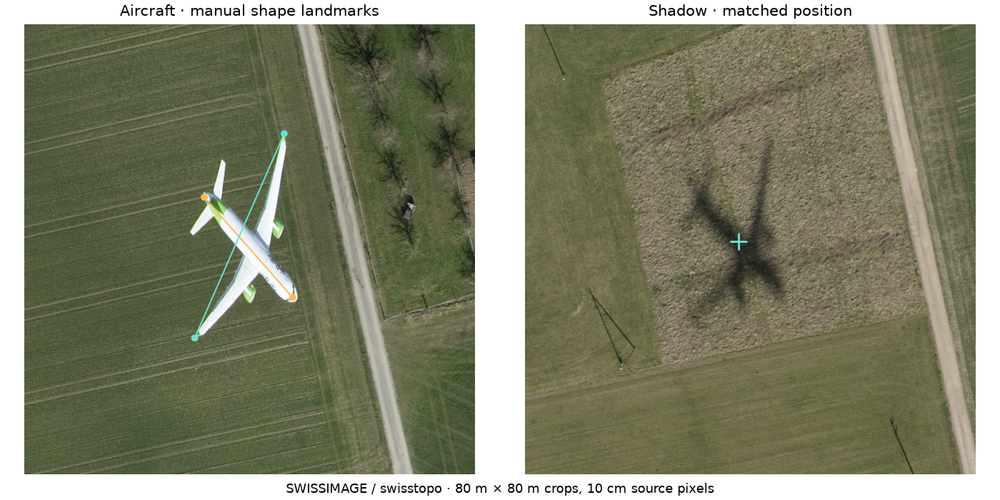
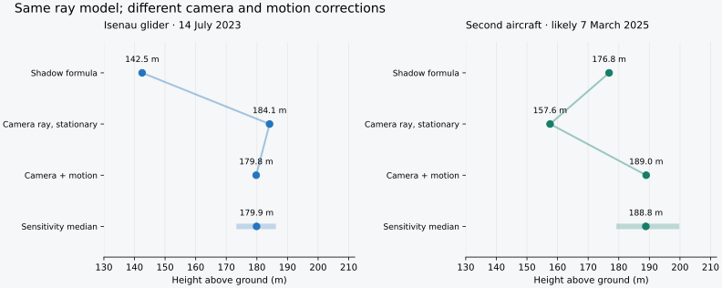

# A second aircraft: does the glider method transfer?

**Yes as a geometric consistency test: the corrected model puts this aircraft at about 189 m above ground and misses the observed shadow direction by only 1.4 m sideways.** This is not independent ground truth for the height. The conditional sensitivity distribution is **188.8 m**, with a **179–200 m central 95% range under the assumptions below**. Its sample standard deviation is 5.2 m.

The new object is a passenger jet, not the original DG-1000. The same sunlight, terrain, camera-ray and moving-scan equations apply, but the jet requires a different motion estimate. Its speed must not be borrowed from the glider.



Imagery © swisstopo, SWISSIMAGE. [Aircraft pin](https://s.geo.admin.ch/xbd4iyyjw6bs) · [Shadow pin](https://s.geo.admin.ch/phjpwmwiosgq).

## Compare the two cases

| Model stage | Isenau glider | Second aircraft |
|---|---:|---:|
| Raw shadow-distance formula | 142.5 m | 176.8 m |
| Camera ray, stationary object trial | 184.1 m | 157.6 m |
| Camera ray + scan motion | 179.8 m | 189.0 m |
| Monte Carlo median | 179.9 m | 188.8 m |
| Conditional central 95% range | 173–186 m | 179–200 m |
| Final absolute sideways shadow mismatch | 0.85 m | 1.44 m |

These rows are successive model calculations, not independent height measurements. The stationary trial fits only the along-Sun component; its remaining sideways mismatch is reported rather than hidden. It is not a satisfactory final model for the jet.



## 1. Locate matching image points

The user pins are 256.35 m apart. Segmentation of all bright aircraft components and matching a blurred copy against the shadow refine the corresponding image positions to:

| Image point | LV95 easting | LV95 northing | Interpolated terrain |
|---|---:|---:|---:|
| Aircraft silhouette reference | 2680573.02 | 1261829.20 | 413.62 m |
| Matched shadow reference | 2680507.24 | 1262078.11 | 409.52 m |

Refined image separation is **257.45 m**. The terrain correction at the image positions is about −4.1 m. Decimal places record the computation, not survey accuracy. The white-mask centroid is a reference point on the planform, not a measured centre of mass. Missing coloured surfaces and vertical tail geometry contribute uncertainty. The shadow-filter score is not interpreted as a calibrated significance level.

The original glider's largest-connected-component rule would discard one disconnected jet wing. The second case includes all aircraft components in a manually identified crop; the original glider analysis is preserved.

## 2. Recover the camera from the strip footprint

For each cross-section, fit the same relation used at Isenau:

```text
width = tan(half_FOV) × (2 × camera_altitude − terrain_north_edge − terrain_south_edge)
```

The **42 sections** give an approximate field of view of **47.4°**, camera altitude **2688 m ASL**, and nadir-track northing **1262259.1**. Width-fit RMS is 5.8 m, R² = 0.982. Bootstrap camera altitude spans 2588–2791 m; this excludes model-systematic errors.

The FOV fit is less precise than Isenau's 45.3° fit and is offset from the original 45.2° sensor reference. Imposing 45.2° instead gives a camera altitude of 2808 m and an aircraft height of **190.4 m**, only **1.4 m** different. This is a sensitivity check, not proof of the camera model.

Here the camera track lies north of the aircraft. Relief correction therefore moves its true horizontal position about **35.4 m north**, toward its shadow. At Isenau the track was south, so the correction moved the glider away from its shadow. The sign comes from geometry; a percentage correction cannot be transferred between the cases.

## 3. Date the exposure without inventing precision

Both map tiles are labelled **2025**. The 2025 strip covering both pins is **20250307_1019_12501**, dated **7 March 2025**, starting at **10:19 UTC / 11:19 CET**. The next strip starts at 10:31 UTC. The exact mosaic source pixels and exposure instant have not been independently traced.

The original speed-plus-turn timing fit was attempted on this day's strips, excluding a 50-minute interruption. Because almost all strips have similar lengths, the fit is poorly identifiable (design-matrix condition number 1039); its fitted speeds of 1171 and 722 km/h are not credible survey-flight estimates. **That narrow timing reconstruction does not transfer reliably.**

Instead, use the conservative bracket **10:19–10:32 UTC**, including minute truncation. The midpoint, 10:25:30 UTC, is illustrative, not measured. At the midpoint the Sun is **35.10° above the horizon**, azimuth **158.08°**. The full bracket is propagated through the sensitivity calculation. No mast heights from Isenau are reused.

## 4. Correct the jet's motion from its shape

The sensor scans west while the jet travels southeast. Opposite wingtips and the fuselage provide an additional constraint: in an approximately level aircraft planform, the span vector is perpendicular to the body axis. The selected landmarks are recorded in the code and shown above; they were not adjusted to improve the shadow match.

For image vectors, let r = (camera_altitude − aircraft_altitude) / (camera_altitude − image_terrain). The inverse scan/relief map is:

```text
B = [[1 − a, 0], [−b, r]]
a = aircraft_east_velocity / signed_scanner_velocity
b = aircraft_north_velocity / signed_scanner_velocity
(B × body_vector) · (B × wing_vector) = 0
```

Assuming nominally zero drift between body direction and ground track gives b/a = r × body_north/body_east. Solving the orthogonality constraint on the physical negative-a branch yields **a = -0.566, b = 0.589**. The Monte Carlo allows ±5° drift. Absolute scanner speed cancels from the motion displacement, so no absolute jet-speed assumption is needed for this correction.

With a hypothetical scanner velocity of −100 m/s, those ratios would imply a jet ground speed of about 82 m/s. This is only an illustration, not a measured speed.

Use the same camera ray and sunlight ray as the glider analysis, with the scan-motion displacement added before comparing the aircraft and shadow positions. Solve for the aircraft altitude, then subtract terrain under its corrected horizontal position. The result is **189.0 m AGL**, altitude **601.0 m ASL**, over terrain at **412.1 m ASL**.

## 5. Keep the sideways direction as a held-out check

Height is solved from the component along the sunlight ray. Motion is inferred from the aircraft shape. **Neither is tuned to make the perpendicular shadow residual vanish.**

| Direction check | Absolute sideways mismatch |
|---|---:|
| Uncorrected image positions | 31.9 m |
| Camera correction, stationary jet | 20.9 m |
| Camera correction + shape-derived motion | **1.4 m** |

The final inferred shadow azimuth is 337.78°, versus 338.08° opposite the Sun, a difference of about 0.30°. This supports the method's geometric consistency in a second, different case. It does not establish absolute height accuracy or prove every assumption.

## Uncertainty and limits

The 10,000 draws vary aircraft position (1 m standard deviation), shadow position (2 m), each shape landmark (0.5 m), camera fit and additional camera-model sensitivity (75 m altitude, 6 m track), unknown time across its full bracket, ±0.5° along-track camera tilt, ±5° drift and 0.7–1 m terrain errors. All draws are retained; none are selected for a small shadow-direction residual. 0 draws failed the physical/numerical checks.

The resulting **179–200 m central 95% range is conditional on those choices**. Banking, vertical motion, non-planar wings and tail, source-mosaic ambiguity and unmodelled sensor geometry can introduce additional errors. There is no telemetry or surveyed aircraft height here to validate the absolute result. Consequently this is reported as **about 190 m**, not as a survey-grade measurement.

## Reproduce and inspect

```sh
uv run --with numpy --with scipy --with pillow python analysis/analyze_second_case.py 10000
uv run --with numpy --with scipy --with pillow python -m unittest discover -s analysis -p 'test_second_case.py' -v
uv run --with matplotlib python analysis/render_second_case.py
```

The analysis is offline using [cached inputs and output](../data/second-aircraft/). [Analysis code](../analysis/analyze_second_case.py) · [physics-recovery tests](../analysis/test_second_case.py). Four new tests verify known-motion recovery, full recovery of a synthetic known aircraft height, footprint coverage of both pins, and rejection of terrain extrapolation. The 12 existing calculator tests also pass. Rerunning the original glider solver reproduces its 184.14 m stationary and 179.77 m moving central results.

To refresh public caches (network required):

```sh
uv run --with numpy python analysis/fetch_second_case_sources.py
uv run --with numpy python analysis/fetch_second_case_terrain.py
```

Source refreshes can change the underlying SWISSIMAGE mosaic; retain the original caches to reproduce these numbers.

## Sources

- [Aircraft location](https://s.geo.admin.ch/xbd4iyyjw6bs) and [shadow location](https://s.geo.admin.ch/phjpwmwiosgq), supplied by the user.
- [Flight strip metadata and footprint](https://api3.geo.admin.ch/rest/services/ech/MapServer/ch.swisstopo.lubis-bildstreifen/20250307_1019_12501?sr=2056).
- [Strip date/time conventions](https://www.swisstopo.admin.ch/en/orthoimage-swissimage-rs): strip IDs encode acquisition start time in UTC.
- [SWISSIMAGE mosaic and acquisition-date limitations](https://www.swisstopo.admin.ch/en/orthoimage-swissimage-10).
- [Terrain height API](https://docs.geo.admin.ch/access-data/get-point-height.html). Source URLs and cache evidence are included in data/second-aircraft/.
- [NOAA solar calculation details](https://gml.noaa.gov/grad/solcalc/calcdetails.html); the same paper/solar.mjs is used for both cases.

No new ground-truth height has been introduced. The comparison demonstrates a transferable geometric model with explicitly different motion and timing constraints.
